  

---

## 👋 About Me

I'm Matin, a technology enthusiast who enjoys exploring computers, software, and programming.

- 💻 Software development and computer science
- 🐧 Linux: exploring, customizing, breaking, fixing
- 🛠️ Building tools, apps, and practical solutions
- 🎮 Gaming
- 🌱 Always experimenting with new technologies and ideas

---

## 🧰 Tech Stack

| Category | Stack |
| :-- | :-- |
| **Languages** |  |
| **Web** |  |
| **Databases** |  |
| **Tools** |  |

---

## 🚀 Featured Projects

| Project | Description |
| :-- | :-- |
| [**dockerscope**](https://github.com/ERROR404DTIR/dockerscope) | Zero-dependency static Dockerfile linter: 20 rules for security, image size, and build reliability. |
| [**a11yscan**](https://github.com/ERROR404DTIR/a11yscan) | Zero-dependency HTML accessibility checker: 22 WCAG-oriented rules and contrast checks. |
| [**mockforge**](https://github.com/ERROR404DTIR/mockforge) | Dependency-free local JSON API mock server with latency simulation and request logs. |
| [**datamint**](https://github.com/ERROR404DTIR/datamint) | Reproducible synthetic datasets from JSON schemas, exported as CSV or JSON. |
| [**iconforge**](https://github.com/ERROR404DTIR/iconforge) | Offline app icon pack generator, running entirely in your browser. |
| [**exifwipe**](https://github.com/ERROR404DTIR/exifwipe) | Strip embedded image metadata locally in the browser; no uploads. |

  <a href="https://github.com/ERROR404DTIR?tab=repositories">See all repositories →</a>

---

## 📊 GitHub Stats

  
  
   
  

---

  <i>"Nothing... just a line."</i>

